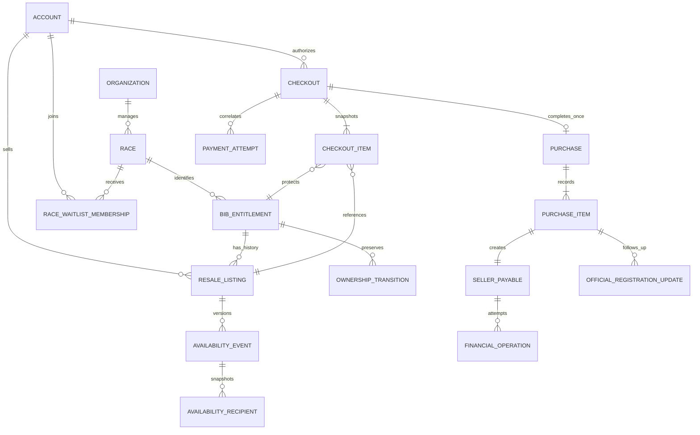

# Domain model architecture plan

Status: architecture direction accepted by the user; concrete implementation names/states remain proposals, 2026-10-08. This is a plan, not implemented models, a migration, or evidence that purchase/payment flows work. Accepted product rules remain authoritative; proposed model names and state labels may evolve during TDD.

Target: the current Symfony 8.1 / PHP >=8.4.1 application. Workspace specifications still describe Symfony 8.2 as a longer-term target; the user's subsequent instruction selected 8.1 for this project. This plan does not silently rewrite the other specification decisions.

## Sources and authority

- [Product rules](../../../specifications/product-rules.md), especially PR-02–PR-11.
- [Logical data model](../../../specifications/backend/data-model.md) and [backend requirements](../../../specifications/backend/specification.md).
- [Transaction and delivery requirements](../../../specifications/backend/implementation-plan.md).
- [Canonical glossary](../../../specifications/glossary.md).
- [Stripe states and acceptance scenarios](../../../specifications/backend/stripe-states-and-tests.md).
- [Open decisions](../../../specifications/decisions-and-gaps.md).

The plan preserves the accepted integrated Twig/UX web app, custom future JSON API, PostgreSQL authority, Redis for disposable data, and Laravel Cloud queue/storage direction. Local Docker is development infrastructure, not proof of Cloud compatibility. Mobile and chat are outside launch implementation.

## Architectural shape

Use one modular monolith and one authoritative PostgreSQL database. Modules isolate ownership of rules and writes; a single application transaction may coordinate several aggregates when a business invariant requires it. Do not split checkout, inventory and ownership into independently committing services.

Keep the existing layer-first structure so Deptrac continues to enforce inward dependencies:

```text
src/
  Domain/
    Identity/ Organizations/ Races/ Inventory/ Listings/
    Availability/ Checkout/ Sales/ Finance/ Support/
    Notifications/ Newsletter/ Shared/
  Application/
    <Module>/Command/       # typed use-case input and handler
    <Module>/Query/         # typed read requests and result DTOs
    <Module>/Port/          # repositories and required external capabilities
  Infrastructure/
    Persistence/<Module>/  # DBAL repositories and record mappers
    Payment/Stripe/        # provider adapter and event translation
    Messaging/ Storage/ Mail/ Security/ Clock/
  Presentation/
    Http/Web/              # Twig controllers and view adaptation
    Http/Api/              # future mobile adapters, when needed
    Http/Webhook/          # signature validation and durable receipt
    Console/               # scheduled command entry points
```

Domain uses plain PHP with no Symfony, Doctrine or provider SDK types. Application owns ports and transaction orchestration. Infrastructure implements those ports. Presentation translates authenticated input to commands and results to responses. Controllers and Messenger handlers never become alternative owners of business rules.

Start with explicit DBAL persistence, already installed, plus a migration package selected at the persistence implementation step. Persistence records/mappers remain in Infrastructure; domain objects carry no Doctrine attributes. Do not add an ORM solely to generate entities. If an ORM is later justified, keep its mapping outside Domain and preserve application interfaces.

Modules communicate through typed application capabilities, stable IDs and committed domain events. No cross-module entity graph, cascading financial deletes or globally writable repository. Query adapters may join tables into purpose-specific read DTOs; this is a read/write separation within the same database, not event sourcing or a second database.

## Model ownership and aggregate roots

An aggregate owns local invariants. Cross-aggregate guarantees are enforced by application transactions plus database constraints, not a promise that every rule fits in one object.

| Module | Aggregate roots / owned records | Main responsibility |
|---|---|---|
| Identity | Account, authentication identities, verification/reset credentials | Account identity, verified state, terms version/time, private profile and anonymization lifecycle |
| Organizations | Organization; membership records owned by organization | Approval, owner-only membership management, scoped manager permissions; one organization per account initially |
| Races | Race; required-field definitions; EligibilityImport with row outcomes; OriginalRegistration | Race identity, participation, optional bounds/deadline, immutable import identity and explicit update protection |
| Inventory | BibEntitlement; append-only OwnershipTransition | Stable race/bib identity, current holder, one platform owner, ownership history independent of listings |
| Listings | ResaleListing; OwnershipProof and ProofReview | Seller ownership/eligibility, proof review, price/publication/withdrawal, at most one live listing per entitlement |
| Availability | AvailabilityEvent with versioned recipient snapshot; RaceWaitlistMembership | One-hour group opportunity, immutable member snapshot, invalidation and public access after expiry |
| Checkout | Cart; Checkout with immutable CheckoutItem snapshots; durable CheckoutItemLock | All-or-nothing authorization, one item per race, recorded acknowledgments, durable exclusive payment protection |
| Sales | Purchase with PurchaseItems; OfficialRegistrationUpdate | Immutable completed sale record; official registration follows its own evidenced lifecycle |
| Finance | SellerAccountReadiness, PaymentAttempt, SellerPayable, FinancialOperation, SellerTransferSuspension, RecoveryReceivable | Payment correlation, exact obligations, provider mutation identity, transfer readiness, holds and recovery |
| Support | Investigation, RefundAuthorization, RecoveryAuthorization, Testimony | Evidence/reason, moderation, super-admin approvals and scope of holds; no direct provider mutations |
| Notifications | Notification, DeliveryAttempt, recipient preferences | Recipient-only history, deduplicated delivery, deadline-aware retry |
| Newsletter | NewsletterSubscription | Unique email, independent subscribe/unsubscribe/rejoin lifecycle; no account/waitlist side effects |
| Operational infrastructure | ProviderEventInbox, OutboxMessage, ScheduledRun, ExecutionClaim, AdministrativeAudit | Durable recovery, repeat-safe scheduling and audit; these are records, not additional marketplace entities |

Avoid embedding a race's entire inventory, all waitlist members, or an account's purchases inside one aggregate. Query/paginate those collections. Ownership proof is a private evidence reference, not publicly serializable content.

## Identity and value objects

Use opaque, typed IDs for account, organization, race, entitlement, listing, availability event, checkout, purchase, payable and financial operation. An infrastructure generator supplies IDs; Domain does not depend on Symfony UID. Decide the physical UUID format with the first migrations.

| Value / policy | Meaning and boundary |
|---|---|
| Money | Integer cents and EUR currency; checked arithmetic; never floats |
| FeeBreakdown / FeePolicy | Per-bib buyer fee, seller margin, buyer total, seller net; immutable calculation snapshot/version |
| BibNumber | Race-local identity; preserve formatting and leading zeros; import normalization must be explicit |
| EmailAddress | Validated email with a documented normalization policy; do not strip provider-specific aliases |
| RegistrationSnapshot | Checkout-time name/email and accepted race-specific fields, with schema version |
| TransferAcknowledgment | Explicit per-nonparticipating-race acceptance with text/version and timestamp |
| Time instant / deadline policies | UTC DateTimeImmutable values; injected application Clock; one hour, 15 minutes and 72 elapsed hours |
| Actor / authority | Authenticated account or explicit scheduled-service authority; authorization is rechecked by use cases |
| ProviderReference | Adapter-supplied opaque reference; never interchangeable with a domain ID |

Keep shared primitives small. Fee and availability policies belong to their owning modules, not a universal Shared service.

At P=10,000 cents, buyer fee=500, margin=750, total=10,500, seller net=9,250. At P=20,000 cents, total=21,000 and seller net=18,500. Sum each item's rounded amounts; never apply minima to seller/cart subtotals. Implement half-up integer ratio rounding with overflow protection. Reject nonpositive price or seller net.

## Relationships



The diagram describes committed checkout aggregates; invalid empty requests never become authorized checkouts. A nullable organization relationship allows nonparticipating races. Seller payables are per purchase item initially; grouping a seller's amounts must preserve item-level claims, holds and attribution. The newsletter has no Account or Waitlist foreign key.

Imported original registrations can exist before their runner has a platform account. Preserve an original-holder reference; do not fabricate accounts from imported email. Proposed entitlement representation: exactly one current-holder reference, with an optional current platform-account ID until verified ownership is claimed. Claiming an original entitlement binds its eligible holder to an account atomically; after a purchase the platform-account ID is mandatory. Imported eligibility and purchase-document review establish claims through different proof paths. Current platform ownership is distinct from official race registration and its update state.

## Separate state dimensions

These are proposed labels, not provider event names or accepted database enums. Finalize commands and guards through behavioral tests.

| Model | Lifecycle and independent dimensions |
|---|---|
| ResaleListing | Draft → review pending → published → sold or withdrawn; rejected proof remains distinct from sale outcome. Price revisions invalidate the old availability event. Seller readiness is a separate gate. |
| OwnershipProof | Submitted → approved/rejected, with actor/reason/time; evidence replacement requires a new review. Relisting uses recorded platform ownership without reactivating an old listing. |
| AvailabilityEvent | Active or invalidated; group/public access is derived from recipient snapshot and persisted deadline, not a cron-updated enum. |
| Checkout | Authorized → payment pending/processing → completed; cancellation requested → recovery pending or safely cancelled; definitive failure is separate from unknown provider outcome. |
| CheckoutItemLock | Protected → released or consumed; persisted initial expiry and processing protection/reconciliation state. Expiry alone never releases uncertain payment protection. |
| Purchase | Immutable completed record; refund/dispute facts are separate records. A refund must not delete or silently reverse this history. |
| OfficialRegistrationUpdate | Requested → applied only with evidence; failed/retry/investigation are follow-up states and never gate purchase completion. |
| SellerPayable | Unpaid → transfer pending/unknown → transferred; eligibility time, holds, seller suspension and failure streak are separate dimensions. |
| FinancialOperation | Prepared → submitted → confirmed/definitively failed/unknown; retry the same uncertain identity only through reconciliation. |
| SellerAccountReadiness | Not configured / information required / verification pending / ready / restricted; backend confirmed and timestamped. |
| RecoveryReceivable | Outstanding amount plus confirmed recoveries; pending/failed recovery does not count as recovered. |

A published listing may have a checkout lock without changing publication into a generic "reserved" status. Locked sellers cannot edit price or identity. Withdrawal during payment is allowed as a cancellation request for the whole checkout, invalidates availability, and preserves protection until reconciliation. Withdrawal after completed purchase is rejected.

## Proposed PostgreSQL schema safeguards

Exact SQL, migration ordering and indexing will be designed and tested at implementation. The following guarantees must survive concurrent requests and process restarts:

- Unique race + canonical bib number on entitlements/original registration identity.
- Unique current owner account + race for claimed entitlements; unclaimed original registrations do not create platform-account ownership.
- At most one live listing per entitlement, enforced by a partial uniqueness constraint over explicitly defined live publication states.
- Unique account membership across organizations initially, plus unique membership within an organization.
- Unique current waitlist account/race membership; unique availability-event/recipient snapshot rows.
- Unique checkout/race and checkout/entitlement items; unique protected lock per entitlement.
- A durable buyer/race guard row with one pending checkout claim serializes simultaneous attempts for different bibs in the same race. Keep a stable guard row for locking; do not rely on a query that finds no owner and therefore locks nothing.
- Unique checkout completion/purchase and unique ownership-transition effect identity; unique payable per purchase item.
- Unique provider/event receipt, semantic financial-operation identity, provider-object correlation and consumer/effect deduplication key.
- Unique scheduled job/local-run-date identity; claims have attempt identity and fencing generation. A lease expiry alone does not authorize repeating a financial operation with unknown outcome.
- Constraints reject invalid cents, currencies, totals or required timestamps. Aggregate code validates fee arithmetic; database checks additionally protect structural consistency.
- Foreign keys preserve historical references; account anonymization never cascades through purchases, payables, operations or audit. Store protected personal snapshots separately with category-specific retention.

Use optimistic versions for ordinary edits and row locks for checkout/ownership/financial transitions. Lock ordering is global and deterministic across authorization, withdrawal, completion and cancellation; discover candidate IDs first, lock in order, then reread and validate. Concurrency tests must cover deadlock/retry behavior, not just successful sequential transactions.

## Transaction boundaries and external effects

| Use case | Single PostgreSQL transaction | After commit / reconciliation |
|---|---|---|
| PublishListing / ChangeListingPrice | Check current owner, proof/readiness, bounds/deadline; guard snapshot against membership changes; create listing version and recipient snapshot; invalidate old event; append outbox | Dispatch versioned notifications through the outbox; delivery cannot change eligibility or deadlines |
| AuthorizeCheckout | Validate actor, all offers/versions, deadlines, ownership guards, registrations, explicit acknowledgments and fees; acquire every item lock or roll back; persist snapshots and payment-operation intent | Create hosted provider Session using the recorded operation identity; no database lock held during network call |
| ReceiveProviderEvent | Persist authenticated deduplicated receipt | Worker resolves correlation and authoritative provider outcome; acknowledge delivery only after durable receipt |
| CompletePurchase | Serialize against withdrawal/cancellation; verify full amount/currency and ownership; create whole purchase, all ownership transitions, sold listings, waitlist removals, payables and outbox atomically | Receipt/notifications and official registration follow-up, deduplicated |
| WithdrawListing / CancelCheckout | Invalidate withdrawn offer; mark whole checkout cancellation intent; preserve uncertain locks and record recovery intent | Expire/reconcile provider Session and recover collected funds before safe lock release |
| PrepareSellerTransfer | Claim unpaid eligible payable; recheck holds/suspension/readiness and authority; persist financial operation/fencing identity | Call provider outside transaction; record confirmed, failed or unknown result in a new transaction |
| ApproveRefund / AuthorizeRecovery | Check super-admin, scope, amount, reason and evidence; persist authorization/audit and operation intent | Adapter executes approved operation; confirmed effects update monetary records; ownership effects stay gated by unresolved policy |

Publication and waitlist join/leave serialize on the same race-scoped snapshot guard. Checkout eligibility uses the authorization instant and original availability snapshot even if payment completes after the one-hour boundary. All affected aggregates share the same database connection and unit of work.

Outbox consumers include Notifications, OfficialRegistration and operational follow-up. Exactly-once business effects come from committed identity/constraints and repeat-safe handlers; transport delivery remains repeatable. Redis loss cannot change a lock, snapshot, deadline, owner or payable.

A financial operation journal is required; full general-ledger/event-sourcing architecture is not selected. Preserve immutable original amounts, beneficiary and operation parameters; append attempts/results rather than overwriting evidence. Customer-policy refund, technical duplicate correction, seller transfer, bank payout observation and authorized recovery have different operation kinds and authorities.

## Application interfaces and read models

Proposed application ports are added only when a use case needs them:

- AccountRepository, OrganizationRepository, RaceRepository, EntitlementRepository, ListingRepository, AvailabilityRepository, CheckoutRepository, PurchaseRepository and PayableRepository: aggregate-specific load/save capabilities; avoid a generic CRUD base repository.
- TransactionManager and explicit concurrency/claim capabilities: all participating repositories share the transaction. Domain never starts a transaction.
- PaymentGateway, SellerAccountGateway, SellerTransferGateway and RecoveryGateway: semantic commands/outcomes; provider SDK DTOs stop at Infrastructure. Application does not expose unrestricted provider mutations.
- Clock, IdGenerator, PrivateEvidenceStorage, MailDelivery and OfficialRegistrationGateway: deterministic or external boundaries.
- OutboxWriter, ProviderInbox and AuditWriter: transaction-aware durable records.

Public read models: RaceSummary, ListingOffer, MyCart, CheckoutProgress, PurchaseReceipt, SellerPayableSummary, OrganizationRaceRoster and AdminInvestigationSummary. Select fields explicitly; never serialize domain/persistence objects directly. Public catalogs omit emails, proof references and provider identifiers. Views distinguish platform purchase, official registration and bank settlement.

Keep current Health use case in its existing module. Add module-specific Deptrac restrictions when the first cross-module interaction exists; current layer checks remain active. Domain modules exchange IDs/value snapshots or deliberate shared policies, not concrete Infrastructure classes.

## Test coverage acceptance

User accepted the model architecture and requested near-100% test coverage. Target 100%; enforce at least 98% line coverage over all hand-written src/ code and 100% line coverage for Domain/Application. Include uncovered files in the denominator, including Infrastructure/Presentation and the composition root. Aim for 100% branch coverage of business rules and explicitly exercise failures, boundaries, role checks, retries, duplicate events and recovery.

Use complementary unit, PostgreSQL integration and HTTP tests through public seams. Concurrency and real provider test-mode scenarios remain required even when line coverage is 100%. Do not game the percentage with internal implementation tests or exclusions of difficult code. Document and review any generated-code exclusion. CI runs `make coverage`, publishes HTML/Clover artifacts and rejects insufficient coverage. Branch coverage is a test-design target; the initial automated gate measures line coverage.

## Selected quality toolchain

PHPUnit is the selected test runner. PHPStan level 10 with Symfony/PHPUnit extensions analyzes src/, tests/ and tools/ without a baseline. PHP CS Fixer enforces Symfony style. Deptrac enforces inward dependencies. Infection mutates Domain/Application with minimum 90% MSI and 95% covered MSI; zero candidates mean no score yet, not a successful model-level mutation result. Composer audit checks dependencies. CI runs the combined `make quality` gate. Review mutation survivors and increase the mutation target as real business slices are implemented.

## TDD delivery slices and proposed seams

Existing approved tests cover HTTP liveness/readiness only. The seams below are proposals for implementation: agree them before writing tests. Do not manufacture failing tests simply to prove a dependency version or directory shape.

| Order | Smallest useful slice | Proposed seam and red → green → refactor evidence |
|---|---|---|
| 1 | Exact fee quote | Public FeePolicy interface: €100/€200 examples, half-cent rounding, minimum fees and nonpositive net rejection; one behavior per cycle |
| 2 | Account and organization authorization | Application commands/queries plus HTTP authorization adapters: owner versus manager, cross-organization denial, independent account roles |
| 3 | Race + original eligibility + entitlement claim | Import/claim application interface with real PostgreSQL: leading-zero identity, duplicate rows unchanged, protected update fields, original holder without fabricated account |
| 4 | Verified publication and relisting | Listing use cases: wrong owner rejected, proof/readiness gates, one live listing under competition, same entitlement with new listing after purchase |
| 5 | Availability opportunity | Application authorize-access/query seam with fake Clock and real snapshot persistence: late member excluded, empty snapshot public, expiry, new price version, stale notification |
| 6 | Atomic checkout authorization | Use-case seam + real DB workers on separate connections: item failure rolls everything back, same-bib competition, buyer/same-race competition, price snapshots and explicit acknowledgments |
| 7 | Authoritative completion and recovery | Checkout application seam with provider-boundary doubles, then authenticated HTTP webhooks and real test-mode provider: duplicates, out-of-order events, withdrawal race, crash/outbox replay |
| 8 | Payables and daily transfer execution | Scheduler/application seams with fake Clock and controlled provider outcomes: 72 hours, Paris DST, holds, next-daily retry, unknown outcome, three actual failures, no duplicate transfer |
| 9 | Follow-up and administration | Official registration/investigation/refund authorization seams: evidenced update, ordinary-admin denial, payout suspension, failed recovery tracked |
| 10 | Launch support and privacy | Newsletter, testimony and anonymization commands: independent email lifecycle, content moderation and retained financial history |

Test PostgreSQL invariants with PostgreSQL rather than SQLite. Do not mock internal aggregates/repositories in place of concurrency evidence. Use controlled provider doubles for deterministic failure injection; separately verify actual provider signatures, correlation, account capability and hosted Checkout behavior in test mode. The ST-01–ST-31 scenarios remain release evidence requirements, not claims of current coverage.

For every implemented behavior: observe one failure at the public seam, implement the minimum passing behavior, then refactor responsibilities while the suite stays green. No model scaffolding for all modules before the first useful slice.

## Unresolved decisions and feature gates

| Open point | Work that can proceed | Gate before affected feature release |
|---|---|---|
| Symfony 8.2 target versus current 8.1 | Framework-independent domain and current 8.1 application | Align accepted runtime/deployment documents before Cloud release |
| Missing resale cutoff default | Race-specific optional configuration and deadline policy | Choose required handling for races without an explicit cutoff; do not invent a date |
| Registration fields and CSV update allowlist | Versioned snapshots and explicit import row outcomes | Agree field definitions, mutability, normalization, encoding and limits |
| Uncertain/abandoned payment recovery | Journal, durable protection and reconciliation interfaces | Set scan cadence/escalation thresholds and validate provider cancellation/recovery mechanics |
| Refund ownership restoration | Financial authorization, audit and confirmed monetary effects | Decide holder/listing consequences explicitly; no automatic relisting/restoration |
| Official registration integration | Separate update records and authorized CSV read models | Agree provider/organizer evidence, fields, retry and receipt wording |
| Proof/financial/newsletter retention | Category metadata, private evidence references and anonymization isolation | Agree durations and open-investigation/legal hold rules before purge jobs |
| Testimony moderation policy | Isolated model and moderator authority | Agree submission/publication rules |
| Provider account/event/recovery mapping | Provider-neutral ports and operation identity | Verify concrete adapter behavior against current provider documentation/test mode |

Next implementation target: the fee policy, followed by race/entitlement identity and persistence constraints. This gives executable model rules before the more expensive asynchronous payment integration. No business models, ORM package or migrations are installed by this planning task.
